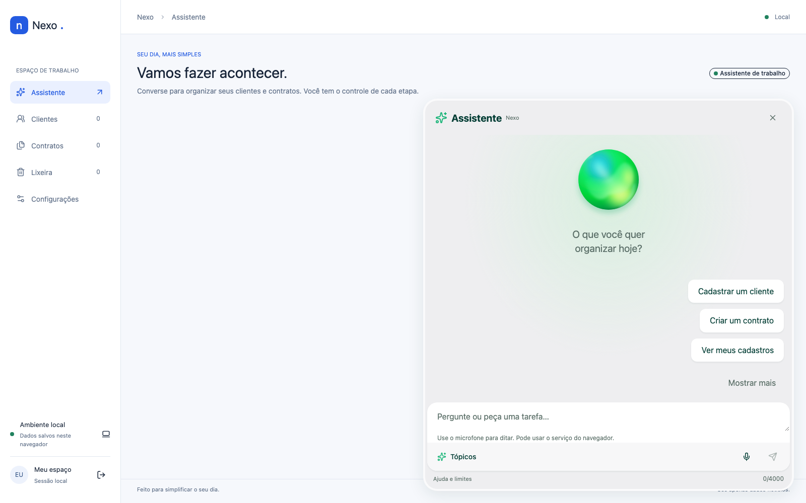
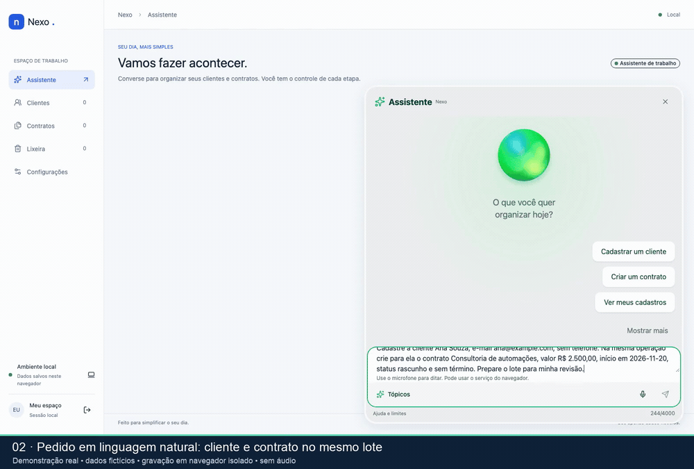
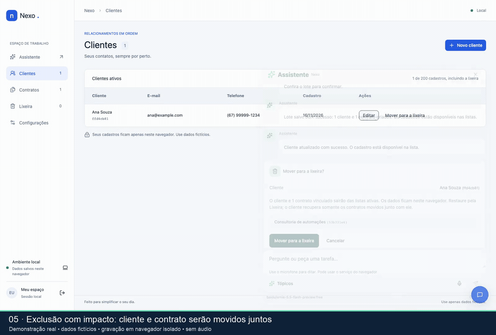

# Assistente local com Genkit

Aplicação experimental de **Daniel Kyochi** para transformar pedidos em linguagem natural em ações visíveis sobre clientes e contratos. O assistente navega, preenche formulários, identifica pendências e prepara cadastros em lote. A pessoa revisa os valores e confirma a gravação.

O projeto explora agentes com ferramentas e automação de tarefas administrativas usando **Nuxt, Vue, TypeScript, Genkit e OpenRouter**. Foi desenvolvido como projeto pessoal de estudo e portfólio. A interface mantém o nome **Nexo**.

> Executa em localhost, para uma pessoa e uma aba ativa, com dados fictícios. Os cadastros ficam no navegador. A inferência de IA usa um serviço remoto; o modelo não roda localmente.

## O problema que resolve

Cadastrar um cliente e criar seu contrato costuma exigir alternar entre telas, copiar informações e preencher vários campos. Aqui, um pedido reúne essas etapas:

> “Cadastre Ana Demo, ana@example.com, e crie para ela um contrato de Consultoria no valor de R$ 1.500, com início em 2026-12-01.”

O assistente prepara os dados e o vínculo entre os registros. Se faltar algo, pergunta. Antes de salvar, apresenta uma revisão. **Uma resposta como “sim” no chat não substitui o clique de confirmação.**

A proposta é reduzir navegação e preenchimento repetitivo sem delegar ao modelo a decisão final de gravar. Ainda não há estudo comparativo de tempo economizado; o projeto demonstra o fluxo e seus controles, sem prometer uma porcentagem de produtividade.

## Demonstração

[](docs/media/demonstracao.mp4)

**[Assistir ao vídeo completo](docs/media/demonstracao.mp4)** · [Legendas](docs/media/demonstracao.srt) · [Evidências da execução](docs/media/evidencias.json)

Gravação de 59 segundos, sem áudio e com legendas incorporadas, em navegador isolado. Mostra um pedido real ao modelo `baidu/ernie-5.5-flash-preview:free`, revisão e criação do lote, edição manual, exclusão com impacto, restauração, catálogo e persistência após recarregar. Não há respostas de IA simuladas nessa gravação.

### Cadastro de cliente e contrato em lote



### Exclusão com revisão e restauração



O [guia de demonstração](docs/guia-demonstracao.md) detalha a gravação e os cenários para repetir. É uma execução bem-sucedida, não uma medição de taxa de sucesso, economia de tempo ou qualidade geral do modelo.

## Funcionalidades

| Recurso | Comportamento |
| --- | --- |
| Chat com ferramentas | Interpreta o pedido e solicita ações tipadas; mostra o modelo efetivamente utilizado. |
| Navegação assistida | Exibe o destino antes da troca de tela e preserva a conversa no painel flutuante. |
| Clientes e contratos | Criação, consulta e edição por formulário; o assistente também prepara os rascunhos. |
| Revisão humana | Mostra os dados atuais antes de criar, editar, excluir ou restaurar. |
| Cadastro em lote | Até dez novos registros, incluindo clientes e contratos relacionados, com uma revisão e uma escrita local. |
| Lixeira | Exclusão reversível com impacto explícito sobre os contratos do cliente. |
| Modelos configuráveis | Catálogo, busca, filtros, escolha do principal e alternativo opcional, com tarifas visíveis. |
| Estimativa de custo | Simulação por volume de tokens em USD e BRL, com origem e data da cotação. |
| Ditado | Reconhecimento de fala do navegador; preenche o campo para revisão e nunca envia sozinho. |
| Persistência local | Cadastros, rascunhos e histórico visível permanecem após recarregar a página. |

## Como funciona

```mermaid
flowchart LR
    Pessoa[Pedido em linguagem natural] --> UI[Nuxt e Vue]
    UI --> API[API local Nitro]
    API --> Genkit[Genkit + OpenRouter]
    Genkit --> Proposta[Ferramenta tipada]
    Proposta --> Validacao[Validação no navegador]
    Validacao --> Rascunho[Navegação ou rascunho]
    Rascunho --> Revisao[Cartão de revisão]
    Revisao --> Confirmacao[Clique da pessoa]
    Confirmacao --> Storage[localStorage]
```



O modelo dispõe de cinco ferramentas: `navigate`, `patch-draft`, `request-review`, `request-delete` e `prepare-batch`. Nenhuma delas salva registros. A escrita é uma operação da aplicação, validada novamente no momento da confirmação.

Cada rascunho tem ID e revisão. Alterar um campo invalida o resumo anterior. Em um lote, clientes e contratos são validados juntos e gravados em um único documento: falha de armazenamento não deixa metade dos cadastros salva. O protocolo usa streaming SSE e confirma o resultado das ações executadas no navegador.

Veja [arquitetura e decisões técnicas](docs/arquitetura.md).

## Executar localmente

### 1. Requisitos

- Node.js na versão de [`.node-version`](.node-version), atualmente `24.22.3`.
- npm e um navegador moderno; Google Chrome é usado nos testes de navegador.
- Chave OpenRouter somente para conversar com o modelo. O CRUD manual funciona sem ela.

```bash
git clone https://github.com/kyochi-daniel/assistente-local-genkit.git
cd assistente-local-genkit

# Se usa fnm:
fnm install
fnm use

npm ci
cp .env.example .env
```

Não repita `cp` sobre um `.env` já configurado. Preencha o arquivo local no editor:

| Variável | Finalidade |
| --- | --- |
| `NUXT_LOGIN_USER` | Usuário de acesso ao protótipo, definido por você. |
| `NUXT_LOGIN_PASSWORD` | Senha local, definida por você. |
| `NUXT_SESSION_SECRET` | Segredo aleatório de pelo menos 32 bytes para a sessão. |
| `NUXT_ALLOWED_ORIGIN` | Origem exata da aplicação; padrão `http://localhost:3000`. |
| `NUXT_OPENROUTER_API_KEY` | Chave privada para inferência; pode ficar vazia para usar o CRUD manual. |
| `NUXT_OPENROUTER_MODEL` | ID do modelo principal. |
| `NUXT_OPENROUTER_FALLBACK_MODEL` | ID do alternativo; vazio desativa fallback. |

Para gerar o segredo diretamente no `.env`, sem imprimi-lo, execute uma vez após copiar o exemplo:

```bash
node --input-type=module -e 'import { readFileSync, writeFileSync } from "node:fs"; import { randomBytes } from "node:crypto"; const p = ".env"; const s = readFileSync(p, "utf8"); if (!/^NUXT_SESSION_SECRET=$/m.test(s)) throw new Error("O campo deve estar vazio; segredo existente preservado."); writeFileSync(p, s.replace(/^NUXT_SESSION_SECRET=$/m, "NUXT_SESSION_SECRET=" + randomBytes(32).toString("hex")), { mode: 0o600 });'
```

O `.env` é ignorado pelo Git. Nunca coloque essas credenciais no código, nas variáveis `NUXT_PUBLIC_*`, em capturas de tela ou em gravações.

### 2. Iniciar

```bash
npm run dev
```

Abra **http://localhost:3000** e entre com as credenciais que configurou. Mantenha uma única aba ativa. Se usar outra porta, ajuste também `NUXT_ALLOWED_ORIGIN` para a origem exata. Reinicie o servidor depois de alterar o `.env`.

### 3. Escolher o modelo

O exemplo de ambiente usa `baidu/ernie-5.5-flash-preview:free`, sem alternativo. IDs, preços, quotas e disponibilidade dependem do provedor e podem mudar.

Na página **Configurações**, busque o modelo, confira a compatibilidade e o custo, selecione o principal e clique em **Aplicar alterações**. A preferência guarda somente IDs no navegador. A chave continua no servidor. Escolher um modelo ou simular custos não inicia inferência.

Modelos pagos podem ser escolhidos explicitamente. Não há fallback pago oculto. A configuração gratuita foi avaliada com limitações: ERNIE e Ling completaram apenas um dos três cenários comparados no registro histórico. Confira sempre os campos e os cartões; texto do modelo dizendo “feito” não prova que uma ação ocorreu.

## Onde os dados ficam

| Informação | Local e uso |
| --- | --- |
| Clientes, contratos, rascunhos e até 40 mensagens | `localStorage` do perfil do navegador. Sem banco de dados da aplicação. |
| Preferência de modelos | Chave separada no `localStorage`, contendo apenas IDs. |
| Usuário, senha, segredo de sessão e chave OpenRouter | Ambiente privado do servidor Node.js. |
| Sessão | Cookie HttpOnly; não é uma flag de login no `localStorage`. |
| Pedido e contexto do chat | Enviados ao servidor local e ao provedor remoto durante a inferência. |
| Catálogo e cotação | Consultados pelo servidor e mantidos em cache em memória. |
| Ditado | Capturado pelo navegador; ele pode recorrer a um serviço externo de reconhecimento. |

**Armazenamento local não significa processamento totalmente offline.** O contexto enviado à IA inclui a conversa e os dados necessários para preparar ações. Use apenas informações fictícias. Logout mantém os cadastros locais; limpar os dados do navegador pode apagá-los. Não há isolamento de dados entre pessoas que compartilham o mesmo perfil do navegador.

## Verificação

```bash
npm run typecheck
npm test
npx playwright install chromium
npm run test:e2e
npm run build
```

Os testes E2E de IA interceptam respostas para verificar interface, protocolo e confirmação de forma reproduzível. Os testes unitários também exercitam a integração Genkit/compat-oai com transporte controlado. Isso não mede a qualidade de um modelo remoto.

Para testar o provedor real, com Chrome instalado e chave configurada:

```bash
npm run test:live
```

Esse comando abre janelas isoladas e faz chamadas reais. Pode consumir créditos conforme o modelo escolhido. Execute somente depois de conferir principal, fallback e custo. O ditado automatizado usa áudio sintético e reconhecimento controlado; não comprova precisão de transcrição de fala real.

Na preparação para publicação, `typecheck`, build e 236 testes unitários passaram; a suíte E2E teve 29 aprovações e um cenário ignorado porque o ambiente já possui chave configurada. Esses E2E não representam 29 inferências reais.

O histórico em [execution.md](specs/001-assistente-local/execution.md) registra comandos, resultados, falhas e limites por etapa. As contagens ali se referem àquelas execuções, não a uma garantia de que a versão atual foi testada no seu ambiente.

## Limites do protótipo

- Uma pessoa, uma aba ativa, até 200 clientes e 200 contratos, incluindo a lixeira.
- Até dez registros novos por lote; até seis rodadas e 60 segundos por turno do assistente.
- Sem sincronização, backup remoto, múltiplos usuários, recuperação de senha ou garantia de disponibilidade.
- Sem execução de JavaScript, comandos do sistema ou URLs arbitrárias pelo modelo; não é um agente de automação geral do computador.
- Sem geração de PDF, assinatura, pagamento, anexos, RAG ou múltiplos agentes em runtime.
- O catálogo pode informar capacidades multimodais; isso não habilita anexos no aplicativo.
- Login demonstrativo não protege o armazenamento contra quem controla o computador.
- A API de chat não tem limite próprio de requisições ou orçamento por usuário no servidor; o bloqueio de turno simultâneo é da interface. Não exponha o servidor e configure limites no provedor.
- Dependências transitivas tiveram alertas no audit registrado. A publicação do código não equivale a disponibilizar um serviço pronto para produção. Revise dependências e arquitetura antes de expor o servidor na internet.

## Documentação

- [Arquitetura, dados e decisões](docs/arquitetura.md)
- [Roteiro de demonstração e gravação](docs/guia-demonstracao.md)
- [Especificação funcional](specs/001-assistente-local/spec.md)
- [Plano de implementação](specs/001-assistente-local/plan.md)
- [Modelo de dados](specs/001-assistente-local/data-model.md)
- [Protocolo do assistente](specs/001-assistente-local/contracts/assistant.md)
- [Autenticação local](specs/001-assistente-local/contracts/auth.md)
- [Execuções e limitações observadas](specs/001-assistente-local/execution.md)

O desenvolvimento foi organizado com especificações, contratos, tarefas e testes, usando Spec Kit. Os documentos em `specs/` preservam também decisões e evidências históricas da construção.
