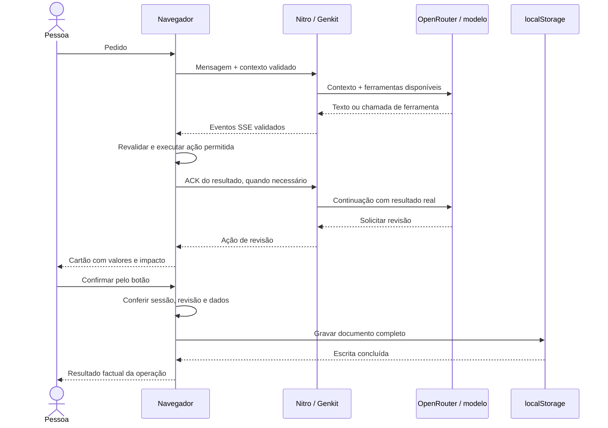

# Arquitetura do assistente local

## Objetivo e fronteira do produto

Este projeto pessoal experimental demonstra como conectar um modelo de linguagem a ações de uma aplicação administrativa. O assistente ajuda a preparar trabalho; a decisão de persistir continua com a pessoa. O caso escolhido é um cadastro de clientes e contratos, pequeno o suficiente para executar localmente e observar cada etapa.

A arquitetura contém uma aplicação Nuxt e seu servidor Nitro. Não há banco, serviço de filas, plataforma de agentes separada ou sincronização remota de cadastros. Publicar o repositório permite estudar e executar o código; não transforma o protótipo em um serviço público ou multiusuário.

## Componentes e responsabilidades

| Camada | Arquivos principais | Responsabilidade |
| --- | --- | --- |
| Páginas e formulários | `app/pages/`, `ClientForm.vue`, `ContractForm.vue` | Visualização e entrada manual dos mesmos dados que o assistente prepara. |
| Chat e revisão | `AssistantPanel.vue`, `ReviewCard.vue`, `BatchCard.vue`, `MutationCard.vue` | Conversa, progresso e confirmação explícita da revisão atual. |
| Estado do workspace | `app/composables/useWorkspace.ts` | Estado reativo compartilhado, rascunhos, revisões e persistência. |
| Turnos do assistente | `app/composables/useAssistant.ts` | Requisições, cancelamento, streaming, ações e continuidade com ACK. |
| Regras locais | `app/utils/actions.ts`, `review.ts`, `mutations.ts`, `batch.ts`, `storage.ts` | Executar somente ações válidas e persistir o resultado confirmado. |
| Contratos compartilhados | `shared/schemas.ts`, `types.ts`, `models.ts` | Schemas Zod estritos, tipos derivados e validação das fronteiras. |
| Entrada de IA | `server/api/chat.post.ts` | Validar sessão, origem, tamanho e conteúdo antes da inferência. |
| Orquestração | `server/ai/assistant.ts`, `genkit.ts`, `history.ts` | Montar contexto, declarar ferramentas, chamar modelo e normalizar continuidade. |
| Acesso local | `server/api/auth/`, `server/utils/auth.ts` | Login configurado no ambiente e sessão HttpOnly. |
| Catálogo e cotação | `server/api/models.get.ts`, `exchange-rate.get.ts` | Consultas externas, cache, validação e respostas reduzidas. |

O estado usa composables do Vue/Nuxt. O mesmo executor atende ao chat e aos formulários, evitando duas implementações de salvamento com regras diferentes.

## Ciclo de uma solicitação

O protocolo não permite que a frase do modelo seja usada como prova de sucesso. Uma navegação lê a rota efetiva após o roteador concluir; uma gravação só anuncia sucesso depois que o armazenamento aceita o novo documento.

### Ferramentas permitidas

| Ferramenta | Entrada essencial | Efeito |
| --- | --- | --- |
| `navigate` | Destino enumerado; ID para edição | Abre tela conhecida. Não aceita URL arbitrária. |
| `patch-draft` | Entidade, ID, revisão esperada e campos | Atualiza rascunho existente. Não grava cadastro. |
| `request-review` | Entidade, ID e revisão | Valida dados completos e apresenta resumo. |
| `request-delete` | Entidade, ID do registro e revisão | Apresenta impacto da exclusão reversível. |
| `prepare-batch` | Clientes, contratos e referências | Prepara ou complementa até dez novos registros. |

Não há ferramenta `save`, execução de código, seletor DOM ou comando de sistema. Restauração é uma ação da lixeira com confirmação local. Não existe coordenação entre múltiplos agentes em runtime.

### Streaming e continuidade

O cliente lê eventos SSE incrementais, inclusive quando caracteres UTF-8 ou separadores chegam partidos. Uma chamada só é aplicada após o stream completo e validado. Os eventos representam texto, modelo selecionado, ação solicitada, término ou erro.

Cada ação recebe ID. O executor deduplica repetições e devolve um ACK de sucesso, rejeição ou erro. O histórico técnico conserva a relação entre chamada e resultado; não aceita mensagens `system` nem ferramentas arbitrárias vindas do cliente. Só há um turno ativo por vez.

Parar ou perder a sessão aborta a requisição e invalida eventos tardios. Isso não desfaz uma operação que a pessoa já confirmou. O limite é de seis rodadas e 60 segundos por turno, contando inferência, ação e ACK.

## Persistência e integridade

### Documento local

A chave `genkit-assistant:v1` contém `schemaVersion`, clientes, contratos, mensagens, rascunho e, quando presente, lote pendente. A leitura ocorre após hidratação no navegador e passa por schema. Conteúdo inválido não é silenciosamente substituído por um workspace vazio.

Clientes possuem nome e contatos opcionais. Contratos referenciam um cliente por UUID, mantêm valor inteiro em centavos, início, término opcional e status. Os schemas rejeitam campos extras, IDs duplicados e contrato sem cliente existente. O término não pode anteceder o início.

A capacidade é de 200 clientes e 200 contratos, contando registros na lixeira. O histórico visível retém até 40 mensagens. O localStorage pode ficar indisponível, exceder quota ou ser apagado; não é um banco seguro nem um mecanismo de backup.

### Confirmação por revisão

A revisão guarda um snapshot dos campos e a versão do rascunho. Edição efetiva incrementa a revisão e invalida o cartão anterior. IDs e revisões são rechecados no clique de confirmação. Cancelar, recarregar ou encerrar sessão não salva automaticamente.

Criar usa um ID estável de rascunho, prevenindo inserção duplicada pela repetição da confirmação. Editar conserva ID e data de criação e verifica também a revisão do registro original.

### Lotes com dependências

Um lote pode criar cliente e contrato juntos. O contrato aponta para uma referência interna de cliente novo ou o UUID de um cliente ativo. Os IDs definitivos são gerados pelo navegador. Complementar o lote mescla itens por referência, preservando campos omitidos na nova resposta do modelo.

A confirmação valida todos os registros, vínculos, revisões e limites. Um único `localStorage.setItem` grava o documento completo. Em caso de falha, a interface conserva o estado anterior e o rascunho, sem publicar uma lista parcialmente atualizada. Essa atomicidade é local ao documento; não é uma transação distribuída nem resolve concorrência entre abas.

### Lixeira e restauração

A exclusão marca `deletedAt` e `deletionBatchId`. Excluir um cliente também arquiva seus contratos ativos na mesma operação; o cartão mostra quais serão afetados. Restaurar esse cliente recupera apenas os contratos daquele lote. Contratos arquivados anteriormente por outra operação continuam na lixeira.

Não há exclusão definitiva pela aplicação. Limpar o armazenamento do navegador é uma ação externa e irreversível sem cópia prévia.

## Sessão, segredos e dados externos

Usuário, senha e segredo de sessão são configurados no ambiente privado. O cookie `genkit-session` é HttpOnly e SameSite Strict, com validade absoluta de oito horas; usa Secure quando a origem configurada é HTTPS. O limitador de tentativas de login é em memória, adequado somente ao escopo local. A API de chat não possui rate limit, controle de concorrência nem orçamento por usuário no servidor; o bloqueio de turno simultâneo está na interface. Um cliente autenticado pode realizar chamadas fora dela. Mantenha o serviço em localhost e configure limites de consumo no provedor.

A API valida sessão, origem configurada, tipo, tamanho e schemas das entradas. Os argumentos do modelo são validados também no navegador. Esses controles reduzem o espaço de ações possíveis, mas não são uma garantia de imunidade a prompt injection ou a outros ataques.

A chave OpenRouter não é enviada ao cliente. O pedido, histórico e contexto necessário seguem para o provedor remoto. Logo, “sem banco” não significa “sem transmissão de dados”. Use dados fictícios e não encaminhe informações confidenciais neste protótipo.

O login limita o acesso às telas e APIs, mas não separa dados entre usuários do mesmo perfil do navegador. Quem controla o computador consegue acessar o armazenamento. Antes de qualquer deploy público seriam necessários nova análise de autenticação/autorização, isolamento, retenção, limites de uso e dependências.

## Modelos, custos e ditado

A preferência em `nexo:model-settings:v1` contém somente `primary` e `fallback`. `fallback: null` desativa explicitamente o alternativo, mesmo se o ambiente tiver outro valor. O chat captura a escolha no início do turno; mudar a tela de configurações não troca o modelo no meio dele.

O servidor consulta o catálogo OpenRouter, mantém cache e envia resultados paginados. A interface mostra custos e bloqueia modelos conhecidos sem suporte necessário a texto/ferramentas. IDs manuais podem não ter preço ou compatibilidade confirmados. A seleção não dispara inferência; enviar uma mensagem pode gerar custo.

A cotação USD/BRL é referência comercial de venda da AwesomeAPI. Os valores simulados não incluem IOF, spread ou cobranças específicas de outras modalidades e não representam uma fatura real. Falhas ou defasagem são sinalizadas; sem cotação válida, a interface usa USD.

O ditado usa Web Speech API e Web Audio. Pausas não concluem a captura: a pessoa encerra pelo botão, revisa a transcrição e decide enviar. O aplicativo não salva áudio nem o encaminha ao Genkit, mas o navegador pode usar reconhecimento remoto. Os testes automatizados usam áudio sintético e reconhecimento controlado.

## Estratégia de validação

- **Unitários:** schemas, revisão, lote, mutações, storage, autenticação, streaming, modelos, custos e ditado.
- **Integração controlada:** Genkit e adaptador reais com transporte simulado, sem inferência paga.
- **E2E:** páginas, login, preenchimento, revisão e persistência; a IA é interceptada nos cenários determinísticos.
- **Live:** modelo remoto real em contexto isolado de Chrome, com custo e disponibilidade externos.
- **Inspeção visual:** desktop e viewport mobile; emulação não equivale a dispositivo físico ou leitor de tela.

Consulte o [registro de execução](../specs/001-assistente-local/execution.md) para os resultados históricos, os modelos comparados e as falhas observadas. Resultados de testes simulados não devem ser apresentados como desempenho de inferência real.

## Decisões e limitações

A combinação de ferramentas restritas, revisão versionada e persistência determinística é o centro do estudo. Ela permite observar o que o modelo propôs e o que a aplicação realmente fez. LocalStorage e login fixo mantêm o experimento simples, mas limitam seu uso a uma pessoa, uma aba e dados fictícios.

As avaliações gratuitas históricas não demonstraram paridade completa com o baseline anterior. Dependências transitivas do Genkit também tiveram alertas de segurança. O projeto não promete autonomia irrestrita, disponibilidade, economia medida de tempo nem prontidão para produção.
